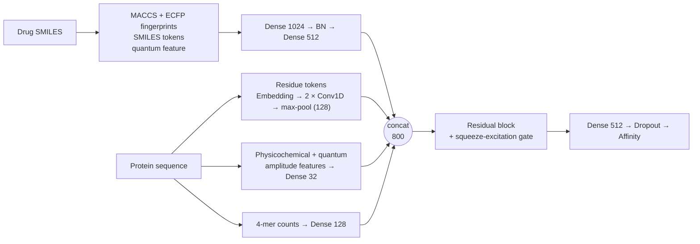
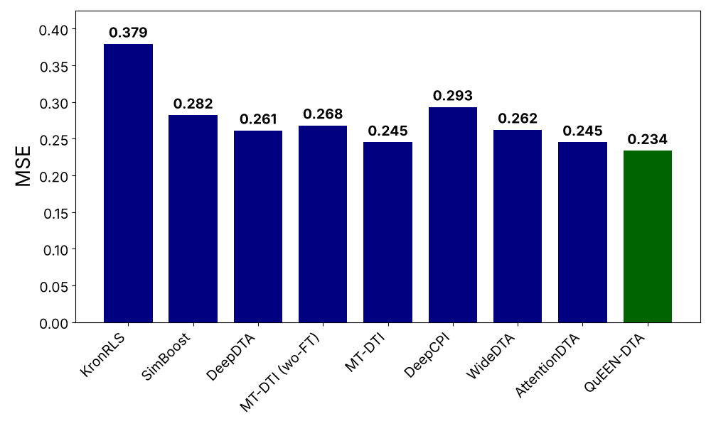
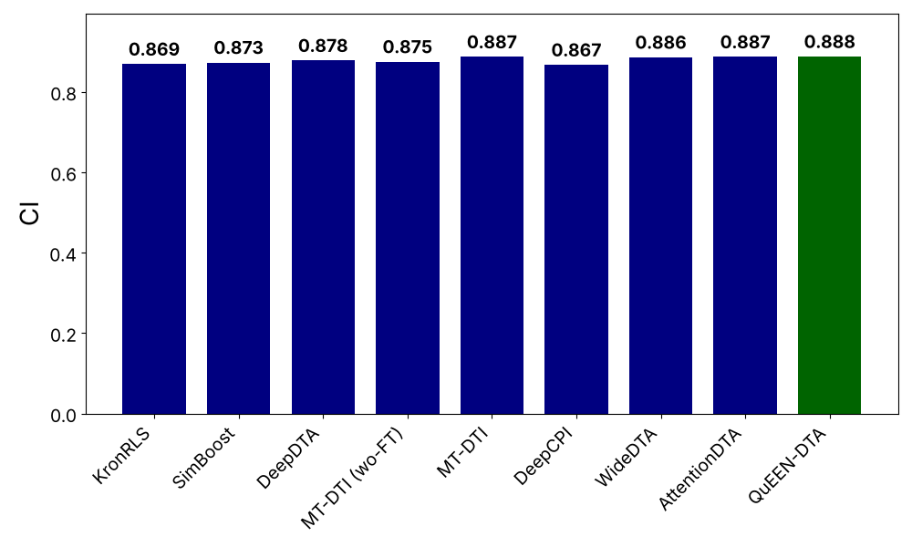
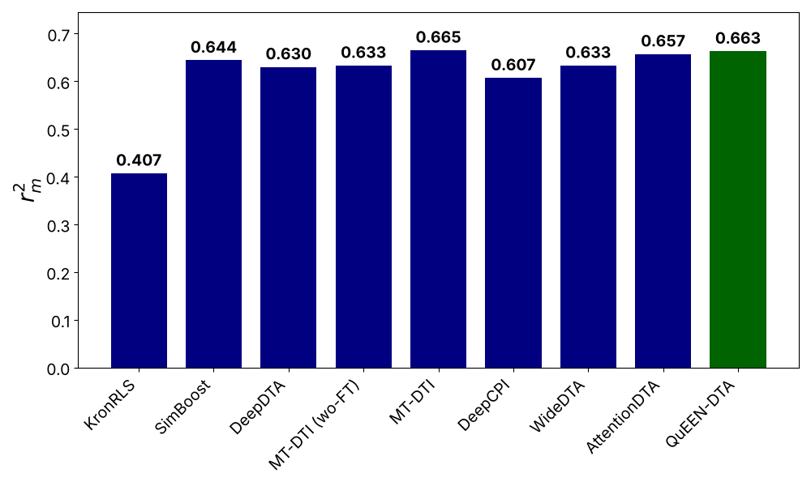
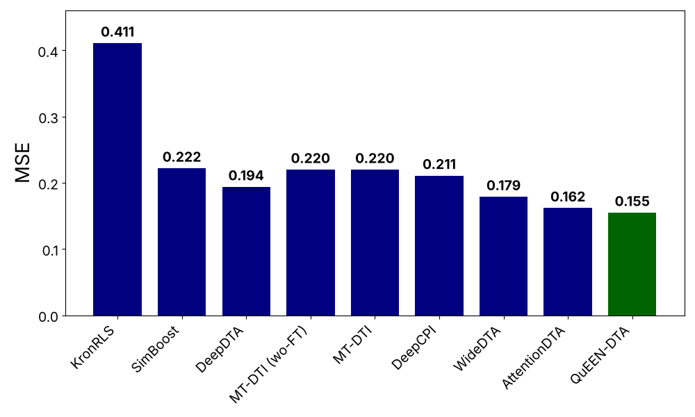
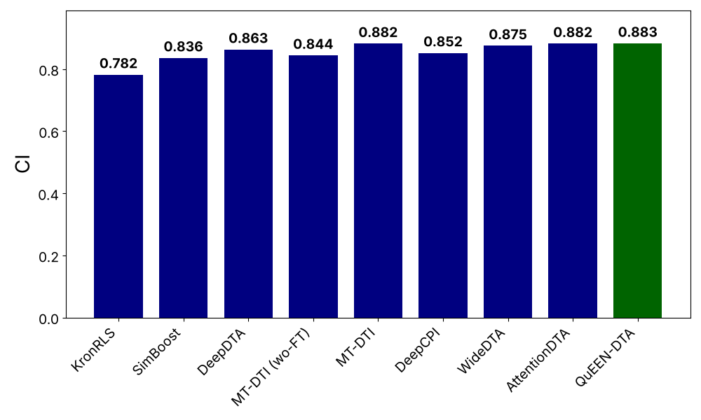
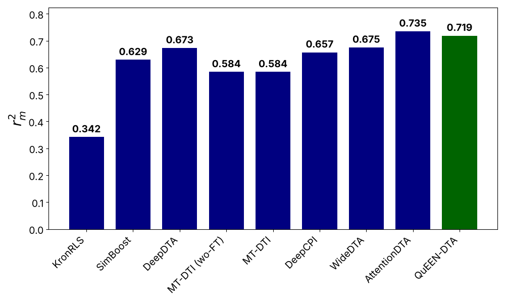

<div align="center">

# QuEEN-DTA

**Quantum-Extreme-Embedding-Network for drug-target binding affinity prediction**

*The QuEEN's Gambit: A New Approach to Predict Drug-Target Affinity*

[](https://www.python.org/)
[](https://pytorch.org/)
[](https://pennylane.ai/)
[](LICENSE)

[Overview](#overview) · [Results](#results) · [Quick start](#quick-start) · [Repository structure](#repository-structure) · [Reproducibility](#reproducibility) · [Citation](#citation)

</div>

---

## Overview

Predicting how strongly a drug binds to a protein (drug-target affinity, DTA) lets researchers
screen compounds before expensive lab work. **QuEEN-DTA** predicts affinity from two inputs only:
the drug **SMILES** string and the protein **amino-acid sequence**.

What makes it different:

- **Multi-head embeddings.** Separate branches encode the drug fingerprints, the protein residue
  sequence, protein physicochemical features and protein 4-mer counts.
- **Quantum amplitude embeddings.** Physicochemical descriptors of the drug and the protein are
  passed through a 2-qubit amplitude-embedding circuit (PennyLane) and added as extra features.
- **Residual fusion with a squeeze-excitation gate** combines the branches before the regression head.

### Architecture



---

## Results

Benchmark: **Davis** and **KIBA**, using the DeepDTA data and one **fixed test fold**; QuEEN-DTA is
trained 5 times per dataset (each of the 5 training folds is the validation fold once, the other 4
are used for training) for up to 200 epochs. Scores are the **mean over the 5 runs on the fixed
test set**. Baseline numbers are quoted from the literature, not re-run
(see [Reproducibility](#reproducibility)).

### Davis (30,056 pairs)

| Model | MSE ↓ | CI ↑ | r<sub>m</sub><sup>2</sup> ↑ |
|:--|:-:|:-:|:-:|
| KronRLS | 0.379 | 0.869 | 0.407 |
| SimBoost | 0.282 | 0.873 | 0.644 |
| DeepDTA | 0.261 | 0.878 | 0.630 |
| MT-DTI (wo-FT) | 0.268 | 0.875 | 0.633 |
| MT-DTI | 0.245 | 0.887 | **0.665** |
| DeepCPI | 0.293 | 0.867 | 0.607 |
| WideDTA | 0.262 | 0.886 | 0.633 |
| AttentionDTA | 0.245 | 0.887 | 0.657 |
| **QuEEN-DTA** | **0.2335** | **0.8878** | 0.6629 |

<p align="center">
  
  
  
</p>

### KIBA (118,254 pairs)

| Model | MSE ↓ | CI ↑ | r<sub>m</sub><sup>2</sup> ↑ |
|:--|:-:|:-:|:-:|
| KronRLS | 0.411 | 0.782 | 0.342 |
| SimBoost | 0.222 | 0.836 | 0.629 |
| DeepDTA | 0.194 | 0.863 | 0.673 |
| MT-DTI (wo-FT) | 0.220 | 0.844 | 0.584 |
| MT-DTI | 0.220 | 0.882 | 0.584 |
| DeepCPI | 0.211 | 0.852 | 0.657 |
| WideDTA | 0.179 | 0.875 | 0.675 |
| AttentionDTA | 0.162 | 0.882 | **0.735** |
| **QuEEN-DTA** | **0.1551** | **0.8827** | 0.7190 |

<p align="center">
  
  
  
</p>

Best value per column in bold. ↓ lower is better, ↑ higher is better.

> **Notes**
> - The tables and charts list the published baselines whose MSE is higher than QuEEN-DTA's
>   (minus GANsDTA and DeepGS, which are left out). Other published models reach a lower MSE
>   (for example the GraphDTA GAT/GIN variants). The complete list is in
>   [`benchmarks/published_baselines.json`](benchmarks/published_baselines.json) and
>   [`results/comparison_with_published_baselines.csv`](results/comparison_with_published_baselines.csv).
> - The gains over the strongest listed baselines are small and about the size of the spread
>   across the 5 runs (see the per-run tables below).
> - On KIBA the source table prints the same MSE and r<sub>m</sub><sup>2</sup> for MT-DTI (wo-FT) and
>   MT-DTI; this is probably a typo there, and the values are copied as printed.

<details>
<summary><b>Per-run scores of QuEEN-DTA (fixed test set)</b></summary>

**Davis**

| Run (validation fold) | Seed | Best epoch | MSE | CI | r<sub>m</sub><sup>2</sup> | R<sup>2</sup> |
|:-:|:-:|:-:|:-:|:-:|:-:|:-:|
| 0 | 0 | 181 | 0.2255 | 0.8890 | 0.7087 | 0.7186 |
| 1 | 1 | 196 | 0.2314 | 0.8913 | 0.6501 | 0.7112 |
| 2 | 2 | 176 | 0.2400 | 0.8896 | 0.6367 | 0.7005 |
| 3 | 3 | 189 | 0.2353 | 0.8847 | 0.6652 | 0.7065 |
| 4 | 4 | 173 | 0.2351 | 0.8846 | 0.6538 | 0.7066 |
| **Mean (std)** | | | **0.2335** (0.0048) | **0.8878** (0.0027) | **0.6629** (0.0246) | **0.7087** (0.0060) |

**KIBA**

| Run (validation fold) | Seed | Best epoch | MSE | CI | r<sub>m</sub><sup>2</sup> | R<sup>2</sup> |
|:-:|:-:|:-:|:-:|:-:|:-:|:-:|
| 0 | 0 | 130 | 0.1748 | 0.8767 | 0.6743 | 0.7428 |
| 1 | 1 | 200 | 0.1521 | 0.8832 | 0.7236 | 0.7763 |
| 2 | 2 | 194 | 0.1488 | 0.8846 | 0.7338 | 0.7811 |
| 3 | 3 | 197 | 0.1534 | 0.8843 | 0.7188 | 0.7743 |
| 4 | 4 | 192 | 0.1466 | 0.8848 | 0.7444 | 0.7843 |
| **Mean (std)** | | | **0.1551** (0.0101) | **0.8827** (0.0031) | **0.7190** (0.0240) | **0.7717** (0.0149) |

Saved in [`results/scores_per_fold.csv`](results/scores_per_fold.csv) and
[`results/scores_summary.csv`](results/scores_summary.csv).

</details>

---

## Quick start

**Requirements:** Python 3.10+ and an NVIDIA GPU (the notebook installs the CUDA 12.6 build of
PyTorch; the code stops with a clear message if no GPU is found).

### Option A: notebook (everything automatic)

1. Open [`notebooks/run_benchmark.ipynb`](notebooks/run_benchmark.ipynb).
2. Run the cells in order. Cell 1 creates a `.venv` inside the repository and installs PyTorch and
   all other libraries there. The install list is at the top of that cell.
3. Cell 3 trains (200 epochs, 5 runs per dataset). Finished runs are saved in `results/` and skipped on a re-run, so you can stop and continue.
4. Cell 4 prints the scores and redraws the charts in `assets/figures/`.

For a quick test set `DATASETS = ["davis"]` and `FOLDS = [0]` in cell 3.

### Option B: command line

```bash
git clone https://github.com/CoffeeIsAllYouNeed/QuEEN-DTA.git
cd QuEEN-DTA
python -m venv .venv && source .venv/bin/activate      # Windows: .venv\Scripts\activate
pip install torch --index-url https://download.pytorch.org/whl/cu126
pip install biopython matplotlib numpy pandas pennylane psutil rdkit scikit-learn

python scripts/run_benchmark.py --datasets davis kiba --folds 0 1 2 3 4   # train
python scripts/summarize_results.py                                      # scores + comparison
python scripts/plot_comparison.py                                        # charts
```

| Script | What it does |
|:--|:--|
| `scripts/run_benchmark.py` | Trains QuEEN-DTA for the chosen datasets and folds, then prints the summary |
| `scripts/summarize_results.py` | Per-run scores, mean and std, and the comparison with the published baselines |
| `scripts/plot_comparison.py` | Draws the six comparison charts into `assets/figures/` |

---

## Repository structure

```
QuEEN-DTA/
├── README.md
├── LICENSE
├── CITATION.cff
├── .gitignore
├── assets/
│   └── figures/                 # comparison charts used in the README and the paper
│       ├── davis_{mse,ci,rm2}_comparison.png
│       └── kiba_{mse,ci,rm2}_comparison.png
├── benchmarks/
│   └── published_baselines.json # baseline scores quoted from the literature
├── data/                        # Davis and KIBA (DeepDTA release), see data/README.md
│   ├── davis/
│   └── kiba/
├── notebooks/
│   └── run_benchmark.ipynb      # one-click launcher (creates .venv, trains, reports)
├── results/
│   ├── scores_per_fold.csv
│   ├── scores_summary.csv
│   └── comparison_with_published_baselines.csv
├── scripts/
│   ├── run_benchmark.py
│   ├── summarize_results.py
│   └── plot_comparison.py
└── src/queen_dta/
    ├── config.py                # protocol and hyper-parameters (all settings in one place)
    ├── dataset.py               # loading and the fixed-test / 5-fold split
    ├── features.py              # fingerprints, token encodings, quantum amplitude features
    ├── model.py                 # QuEEN-DTA network
    ├── optim.py                 # Adam with decoupled weight decay (Keras-style update)
    ├── trainer.py               # training loop, one run per validation fold
    ├── metrics.py               # MSE, CI, r_m^2, R^2
    ├── reporting.py             # per-run table, summary, baseline comparison
    ├── plotting.py              # comparison charts
    └── utils.py                 # seeding, GPU and memory handling, keep-awake
```

Raw per-run outputs (`results/*_fold*.npz` and `.json`, with the predictions) are written when you
train and are ignored by git.

---

## Reproducibility

**Protocol.** The data, split and schedule follow a published benchmark protocol built on the DeepDTA folds, so the results can be set next to the baselines reported for that protocol without re-running them.

| Item | Setting |
|:--|:--|
| Data | DeepDTA Davis (30,056 pairs) and KIBA (118,254 pairs), in `data/` |
| SMILES | RDKit canonical isomeric SMILES |
| Davis label | pKd = -log10(Kd / 1e9); KIBA score used as released |
| Test set | the DeepDTA test fold, fixed (Davis 5,010 pairs, KIBA 19,709 pairs) |
| Train / validation | the 5 DeepDTA training folds; per run 1 fold validates and 4 train |
| Runs | 5 per dataset, mean and std reported |
| Epochs | up to 200 |
| Metrics | MSE, CI, r<sub>m</sub><sup>2</sup> (R<sup>2</sup> also reported) |

**Choices made here** because the reference does not state them (change them in
[`src/queen_dta/config.py`](src/queen_dta/config.py)):

- **Seed:** run *k* uses seed `SEED_BASE + k`, i.e. 0 to 4.
- **Tested weights:** the epoch with the best validation MSE (`SELECT_BEST_VALIDATION = True`).
- **Optimiser:** QuEEN-DTA's own tuned values (batch 64, learning rate 1.31e-4, dropout 0.29, Huber loss,
  weight decay 0.004). `MATCH_REFERENCE_OPTIMISER = True` switches to the reference's values
  (batch 256, learning rate 1e-5, dropout 0.1, MSE loss).
- **AUPC** (reported by the reference) is not computed.

**Hardware.** Results above were produced on a single NVIDIA RTX 3050 (6 GB) laptop GPU.
Training is set to deterministic mode, but small differences between GPUs and library versions are possible.

---

## Citation

If you use this code, please cite the paper (details will be updated on publication):

```bibtex
@misc{queen_dta_2026,
  title  = {The QuEEN's Gambit: A New Approach to Predict Drug-Target Affinity},
  author = {More, Vrushal and Kharche, Shubhangi},
  year   = {2026},
  url    = {https://github.com/CoffeeIsAllYouNeed/QuEEN-DTA}
}
```

Please also cite the dataset release:

- Öztürk, Özgür, Ozkirimli. *DeepDTA: deep drug-target binding affinity prediction.* Bioinformatics 34(17), 2018.

## License

The code is released under the [MIT License](LICENSE). The Davis and KIBA data files in `data/` come from the DeepDTA release and keep their original terms.
